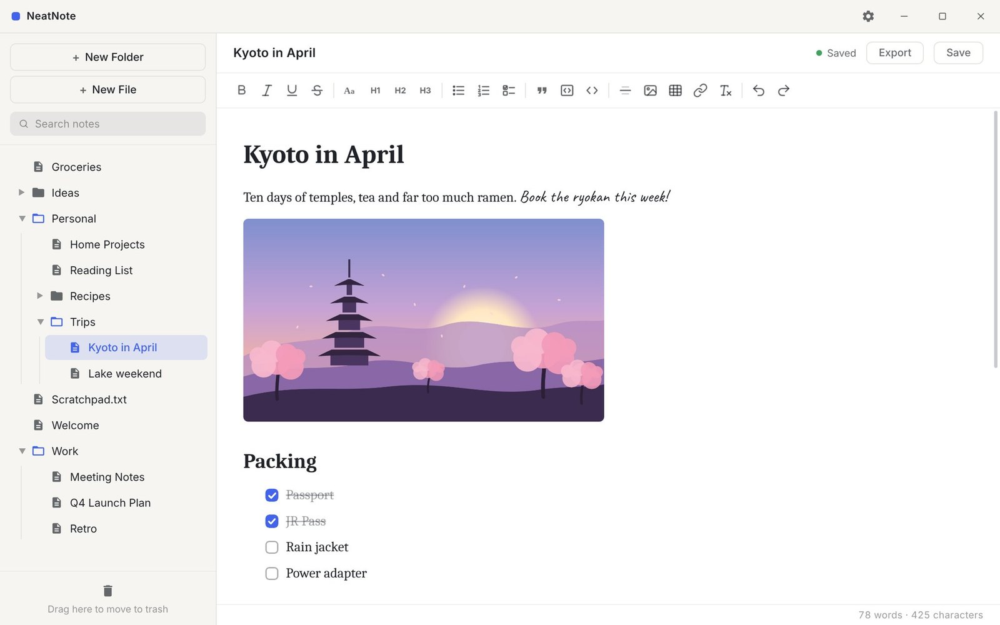
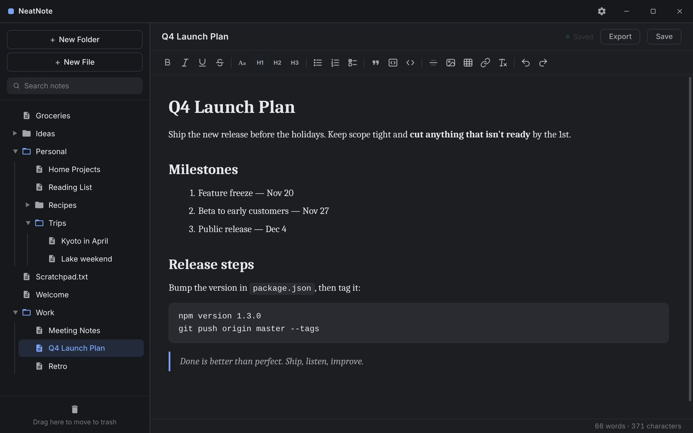
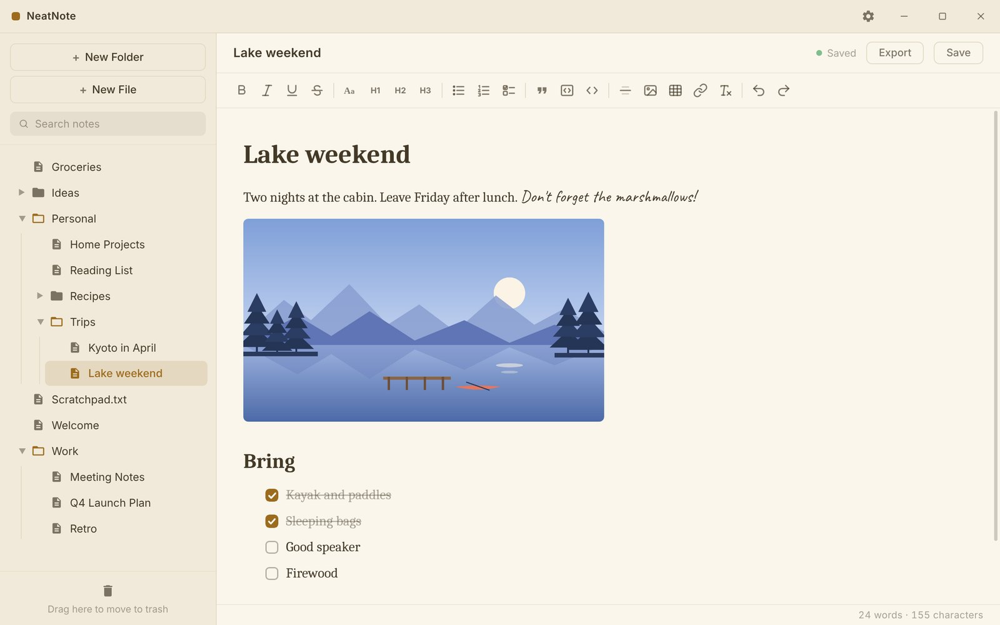
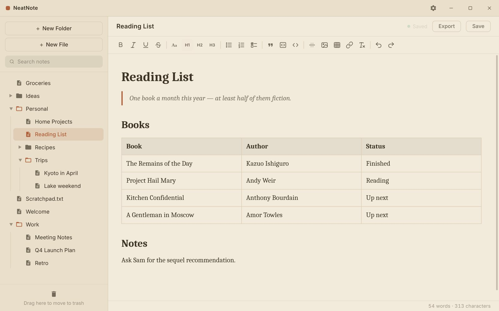
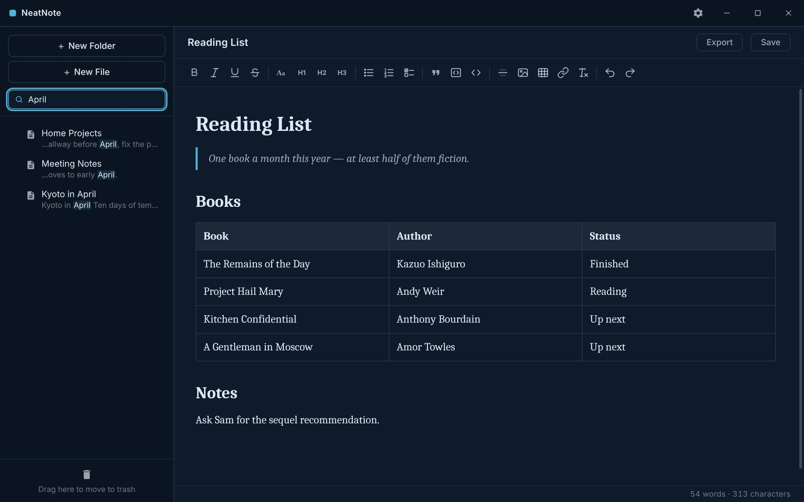
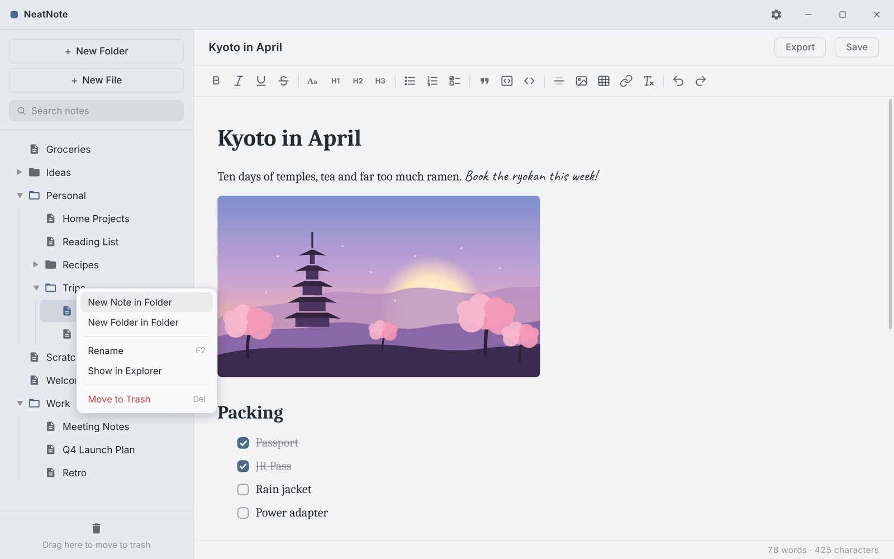
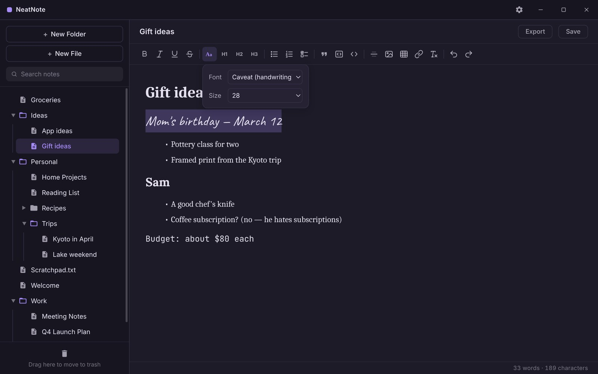

<p align="center">
  
</p>

<h1 align="center">NeatNote</h1>

<p align="center">
  A fast, private, local-first note-taking app for Windows, macOS and Linux.<br>
  <a href="https://theneatnote.com">theneatnote.com</a>
</p>

---

NeatNote sits between a bare text editor and an all-in-one workspace: folders, clean formatting and full-text search, without accounts, sync services or subscriptions. Your notes are ordinary files on your own computer.

<p align="center">
  
</p>

## Features

- **Rich formatting** — headings, bold/italic/underline/strikethrough, bulleted and numbered lists, checklists, quotes, code blocks, links and horizontal rules
- **Fonts and sizes** — 10 fonts (8 bundled, so they look the same everywhere) and sizes from 12 to 40 for any selected text, plus a default font and size in Settings
- **Pictures** — paste, drop or insert; resize with a click; stored as ordinary image files next to your notes
- **Tables** — add rows and columns from the toolbar; Tab and Enter move between cells
- **Nested folders** — drag and drop to move or reorder; right-click to create, rename, reveal or trash
- **Full-text search** — searches inside every note and shows the matching text
- **Export to Markdown** — any note, one click (`Ctrl/⌘ + Shift + E`), including checklists, tables and pictures
- **Saves as you type** — pending edits are written before the window closes; deleted items go to the system trash
- **Safe with other programs** — if a note is changed outside NeatNote, the change is picked up; if both versions were edited, both are kept
- **12 themes** — Light, Dark, Paper, Moss, Dusk, Midnight, Slate, Sand, Rose, Ocean, Ember and High Contrast, plus **Auto** to follow your computer's light/dark setting
- **Keyboard friendly** — arrow-key navigation in the sidebar, `F2` to rename, `Delete` to trash, standard formatting shortcuts
- **Updates built in, if you allow it** — asks once whether to check GitHub for new versions; on Windows it downloads and installs the update for you (always with your OK)
- **Private** — no account and no telemetry; spell check uses bundled dictionaries. NeatNote connects to nothing unless you allow the update check, and that check sends nothing about you or your notes

## Screenshots

<table>
  <tr>
    <td width="50%"><p align="center"><sub>Headings, lists and code blocks · Dark theme</sub></p></td>
    <td width="50%"><p align="center"><sub>Pictures and checklists · Paper theme</sub></p></td>
  </tr>
  <tr>
    <td width="50%"><p align="center"><sub>Tables and quotes · Sand theme</sub></p></td>
    <td width="50%"><p align="center"><sub>Search inside every note · Ocean theme</sub></p></td>
  </tr>
  <tr>
    <td width="50%"><p align="center"><sub>Nested folders and right-click menus · Slate theme</sub></p></td>
    <td width="50%"><p align="center"><sub>Fonts and sizes for any text · Dusk theme</sub></p></td>
  </tr>
</table>

## Download

Ready-to-install builds for Windows, macOS (Apple Silicon and Intel) and Linux (x64 AppImage and .deb) are available at **[theneatnote.com](https://theneatnote.com)** for a one-time $9.99. Buying them funds development.

You're also welcome to build NeatNote yourself from this repository, for free.

## Building from source

Requires **Node.js 22.12 or newer**.

```bash
git clone https://github.com/Atravos/neatnote.git
cd neatnote
npm install
npm start              # run the app
```

Create installers (each platform must be built on that platform):

```bash
npm run build:win      # dist/NeatNote-Setup-<version>.exe
npm run build:mac      # dist/NeatNote-<version>-arm64.dmg and -x64.dmg
npm run build:linux    # dist/NeatNote-<version>-x86_64.AppImage and -amd64.deb
```

Builds are not code-signed, so Windows SmartScreen and macOS Gatekeeper will warn on first launch.

## Tests

```bash
npm test               # unit tests (plain Node)
npm run test:e2e       # end-to-end tests that drive the real app
```

The end-to-end suite opens a NeatNote window and works in a temporary folder — your own notes are never touched. On headless Linux, run it under `xvfb-run -a`.

### Trying the update flow

The app only offers an update when GitHub's latest release is newer than the running version. To see the whole flow against the current release, make the app believe it is older:

```bash
# macOS / Linux
NEATNOTE_UPDATE_TEST_VERSION=1.0.0 npm start
```

```powershell
# Windows (PowerShell), with an installed build
$env:NEATNOTE_UPDATE_TEST_VERSION="1.0.0"; & "$env:LOCALAPPDATA\Programs\NeatNote\NeatNote.exe"
```

Installing from inside the app only happens in an installed Windows build; elsewhere **Update** opens the download page.

## Where notes are stored

| Platform | Location |
| --- | --- |
| Windows | `%APPDATA%\NeatNote\notes` |
| macOS | `~/Library/Application Support/NeatNote/notes` |
| Linux | `~/.config/NeatNote/notes` |

Formatted notes are saved as HTML fragments (`.html`); plain text notes (`.txt`) stay plain text. Pictures are saved as image files in a hidden `.neatnote-images` folder inside the notes folder. **Settings → Open notes folder** opens the folder directly.

## Project layout

```
src/main/       Electron main process: windows, menus, file system, IPC
src/preload/    The only bridge between the page and the main process
src/renderer/   The UI: editor (Quill), sidebar, dialogs, themes
src/styles/     Stylesheets
vendor/         Bundled Quill editor, fonts (OFL licensed) and spell-check dictionaries
installer/      Windows installer hooks
tests/          Unit and end-to-end tests
docs/           Screenshots used in this README
```

See [CHANGELOG.md](CHANGELOG.md) for release notes.

## License

[MIT](LICENSE)
